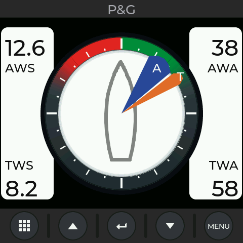
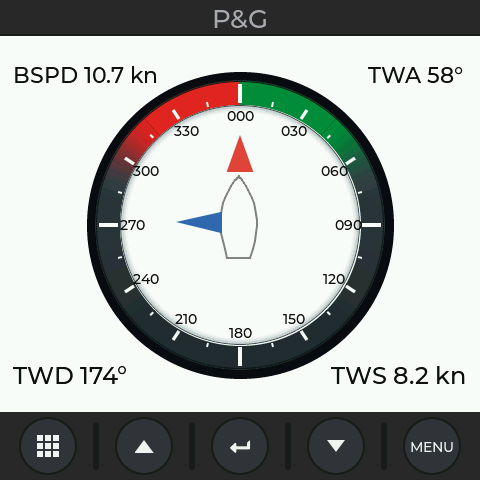
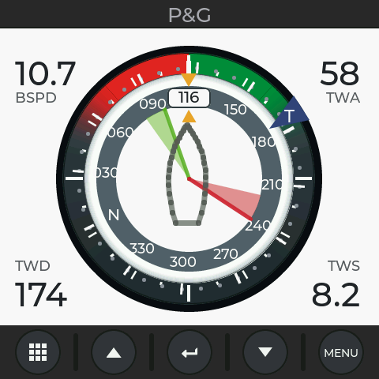
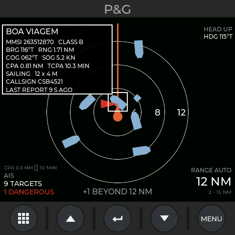
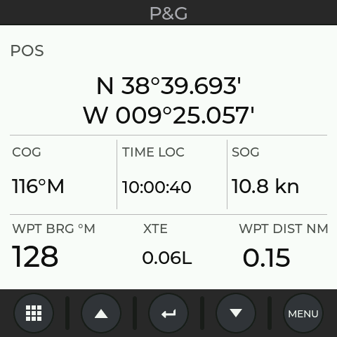
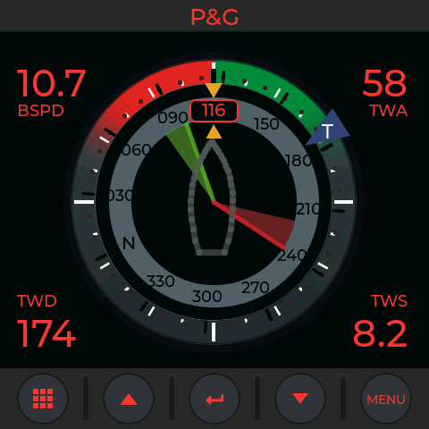

# Marine Display Theme Studio

**▶ [Open the Theme Studio live](https://sail-tech.github.io/marine-display-theme-studio/)** — runs in your browser, nothing to install.

A theme studio and simulator for a marine multifunction instrument display, in two parts:

1. **Web Theme Studio** — a single, self-contained HTML file. A live instrument simulator
   (wind, sailing, navigation, autopilot and AIS pages) with editors for the wind rose, the
   vessel hull, every element colour, night modes, the manufacturer title and the display
   lettering. Runs offline in any modern browser.
2. **Firmware for the Waveshare ESP32-S3-Touch-LCD-4** — a native LVGL port of the instrument
   for the 4-inch 480 × 480 touch board, with touch keys, swipe navigation, an on-screen menu
   and an AIS chart. It loads the themes designed in the web studio.

| Wind Quad | Sail Steer | Laylines |
|---|---|---|
|  |  |  |
| **AIS — selected target** | **GPS** | **Night preset** |
|  |  |  |

*Firmware screens at 480 × 480. They were rendered off-target with LVGL 8.4 from the
firmware's own drawing code (the same `screen.h` / `pages.h` that run on the board).*

> ⚠️ **Simulation only — not for navigation.** All data is generated locally. The firmware
> has no NMEA 2000 / CAN connection, never transmits anything and never commands an
> autopilot. Product and brand names are deliberately generic; this project is not
> affiliated with any instrument manufacturer.

---

## Repository layout

```
web/Marine_Display_Theme_Studio.html   the web Theme Studio (open it in a browser)
firmware/MarineDisplay/                Arduino sketch for the Waveshare ESP32-S3-Touch-LCD-4
  MarineDisplay.ino                    setup, loop, serial command line
  ui.h                                 board bring-up (panel, touch, CH32V003), LVGL, input
  screen.h                             screen layout, keys, drawn areas
  pages.h                              the pages (wind rose, hull, Wind Quad, Sail Steer, Laylines, AIS, GPS, menu)
  draw.h                               painter over LVGL draw primitives
  theme.h                              theme model, presets, night mode, JSON import/export, NVS
  sim.h                                simulated instrument data and AIS traffic
  menu.h                               pages, persisted settings, on-screen menu
firmware/lv_conf.h                     LVGL 8 configuration to use with the firmware
tools/send_theme.py                    sends a theme exported by the web studio to the board
docs/images/                           firmware screen renders
```

---

## Part 1 — Web Theme Studio

Open `web/Marine_Display_Theme_Studio.html` in Chrome, Edge, Safari or Firefox. No server or
internet connection is needed.

The live instrument is on the left; the editor is on the right in four tabs:

| Tab | What it does |
|---|---|
| **Wind Rose** | Vector wind rose (600 × 600 SVG): red/green fade angles, ring radii, inner shadow, colours. Download SVG or a 2000 × 2000 PNG; copy the SVG code. |
| **Hull** | Vector hull outline (420 × 950 SVG, symmetric cubic Bézier): colour and stroke. Bézier control points can be shown. Download SVG or PNG. |
| **Colours** | Original vs edited preview, Day / Night / Amber night / Monochrome presets, manufacturer title, display mode, night text colour, brightness, colour inversion, tide arrow size, **display font and text size**, every element colour (32 + 4 AIS), saved palettes and **Generate final HTML** (a self-contained file with the theme embedded, with or without the studio). |
| **Instrument** | AIS range (2–15 NM) and alarm limits, target table, the simulated NMEA 2000 PGNs, shortcuts to pages, unavailable-data scenarios, key reference and self-tests. |

On the simulated instrument: click the keys, or use **↑ ↓ Enter Esc M** on the keyboard,
or swipe the screen to change page. A long press on MENU opens Display Setup.

**Export theme (.json)** in the top bar saves the whole theme (wind rose, hull, display
settings and colours). The same file loads on the board: see
[Loading a theme on the board](#loading-a-theme-on-the-board).

---

## Part 2 — Firmware for the Waveshare ESP32-S3-Touch-LCD-4

### Hardware

- [Waveshare ESP32-S3-Touch-LCD-4](https://www.waveshare.com/esp32-s3-touch-lcd-4.htm):
  ESP32-S3 (16 MB flash, 8 MB octal PSRAM), 4" 480 × 480 IPS RGB panel (ST7701),
  GT911 capacitive touch, CH32V003 I/O helper (backlight, resets, buzzer).
- A USB-C data cable. Nothing else: no wiring, and the CAN port is not used.

### What runs on the board

- **Pages:** Wind Quad (apparent and true wind), Sail Steer, Laylines, AIS and GPS.
  The wind rose and the hull are the same vector designs as in the web studio.
- **Screen layout:** a title strip with the manufacturer title, the display area
  (480 × 376), and five touch keys at the bottom, as on the simulated instrument.
- **AIS chart:**
  - head-up, with three range rings, the own-vessel marker and the heading line;
  - target symbols: a course-oriented silhouette, a red triangle for dangerous targets
    (CPA and TCPA within the alarm limits) and a diamond for stopped targets;
  - range in steps of 2 · 3 · 6 · 9 · 12 · 15 NM, or **Auto** (widens at once when a target
    leaves the outer ring, narrows after 10 s);
  - tap a target or press **ENTER** to select it. The info panel shows name/MMSI, class,
    bearing, range, COG, SOG, CPA, TCPA, type and size, navigation status or callsign,
    destination, draught and the age of the last report.
- **Simulated NMEA 2000 data model**:
  - AIS: 129038 (Class A position), 129039 (Class B position), 129794 (Class A static and
    voyage data), 129809 / 129810 (Class B static data);
  - own vessel: 129025 (position) by dead reckoning on 129026 (COG/SOG), and 127250
    (heading plus variation).

  Targets are only "received" at their real reporting intervals: about 4 s for Class A
  positions, 30 s for Class B, and 6 min for static data. A target drops off after 3 min
  without a report.
- **Themes:** Day, Night, Amber night and Monochrome presets, brightness (backlight),
  colour inversion, text size and manufacturer title. You can also load full themes from
  the web studio. Everything persists across restarts (NVS).
- **Data scenarios:** heading, position or AIS data unavailable, to see how each page
  degrades.

### Build

**1. Toolchain**

- Arduino IDE 2.x or `arduino-cli`.
- **esp32 by Espressif Systems**, core **3.x** (built with 3.3.11). Boards Manager URL:
  `https://espressif.github.io/arduino-esp32/package_esp32_index.json`

**2. Libraries** (Library Manager)

| Library | Version | Note |
|---|---|---|
| lvgl | **8.4.0** | LVGL 9 is not compatible |
| GFX Library for Arduino | 1.5.3 | moononournation/Arduino_GFX — RGB panel driver |
| SensorLib | 0.2.6 | lewisxhe — GT911 touch driver |
| ArduinoJson | 7.x | built with 7.4.3 |

**3. `lv_conf.h`**

Copy [`firmware/lv_conf.h`](firmware/lv_conf.h) into your Arduino `libraries` folder, next
to the `lvgl` folder (e.g. `~/Documents/Arduino/libraries/lv_conf.h`). The firmware needs
the following from it:

- `LV_COLOR_DEPTH 16` and `LV_COLOR_16_SWAP 0`;
- every Montserrat font from 8 to 48 px (the text-size setting scales through them);
- LVGL's memory pool in PSRAM (`LV_MEM_POOL_ALLOC`).

If you already have an `lv_conf.h` for another project, merge these lines into it.

**4. Board settings**

| Arduino IDE (Tools menu) | Value | `arduino-cli` FQBN option |
|---|---|---|
| Board | ESP32S3 Dev Module | `esp32:esp32:esp32s3` |
| USB Mode | Hardware CDC and JTAG | `USBMode=hwcdc` |
| USB CDC On Boot | Enabled | `CDCOnBoot=cdc` |
| PSRAM | OPI PSRAM | `PSRAM=opi` |
| Flash Mode | QIO 120MHz | `FlashMode=qio120` |
| Flash Size | 16MB (128Mb) | `FlashSize=16M` |
| Partition Scheme | 16M Flash (3MB APP/9.9MB FATFS) | `PartitionScheme=app3M_fat9M_16MB` |

**5. Compile and upload with `arduino-cli`**

Install the core and the libraries:

```bash
arduino-cli core update-index --additional-urls https://espressif.github.io/arduino-esp32/package_esp32_index.json
```

```bash
arduino-cli core install esp32:esp32@3.3.11 --additional-urls https://espressif.github.io/arduino-esp32/package_esp32_index.json
```

```bash
arduino-cli lib install "lvgl@8.4.0" "GFX Library for Arduino@1.5.3" "SensorLib@0.2.6" "ArduinoJson@7.4.3"
```

Compile (from the repository root):

```bash
arduino-cli compile --fqbn "esp32:esp32:esp32s3:USBMode=hwcdc,CDCOnBoot=cdc,PSRAM=opi,FlashMode=qio120,FlashSize=16M,PartitionScheme=app3M_fat9M_16MB" firmware/MarineDisplay
```

Upload (replace the port; on Windows it is `COMx`, on Linux `/dev/ttyACM0`):

```bash
arduino-cli upload -p /dev/cu.usbmodem1101 --fqbn "esp32:esp32:esp32s3:USBMode=hwcdc,CDCOnBoot=cdc,PSRAM=opi,FlashMode=qio120,FlashSize=16M,PartitionScheme=app3M_fat9M_16MB" firmware/MarineDisplay
```

The sketch uses about 1.5 MB of the 3 MB application partition.

In the Arduino IDE: open `firmware/MarineDisplay/MarineDisplay.ino`, set the board options
above, select the port and press **Upload**.

**Prebuilt firmware (no build needed):** download `MarineDisplay-1.0.0-merged.zip` from the
[latest release](https://github.com/Sail-Tech/marine-display-theme-studio/releases/latest),
unzip it and write the full-flash image at address 0:

```bash
python3 -m pip install esptool
```

```bash
python3 -m esptool --chip esp32s3 --port /dev/cu.usbmodem1101 --baud 921600 write_flash 0x0 MarineDisplay-1.0.0-merged.bin
```

**If the port does not appear** (or the upload fails), put the ESP32-S3 in download mode:
hold **BOOT**, press and release **RESET**, release **BOOT**, then upload again. Press
**RESET** after the upload.

### Using the board

| Key | Pages | In the menu |
|---|---|---|
| ▦ PAGES | next page — **hold**: previous page | back |
| ▲ | AIS: widen the range | move up |
| ↵ ENTER | AIS: select the next target (by MMSI, starting at the nearest) | select |
| ▼ | AIS: narrow the range | move down |
| MENU | open the menu | close |

- **Swipe** left / right (or up / down) on the display to change page.
- **AIS:** tap a target to select it; tap empty water to clear the selection.
- **Menu:** tap a row to choose it; tap outside the menu to close it. Items: Page, Display
  scheme, Brightness, Text size, AIS range, AIS alarm CPA, AIS alarm TCPA, Hide safe AIS
  vessels, AIS tracking, Data scenario, Invert colours, Reset theme, About.

### Serial command line

USB serial at 115200 baud (Arduino Serial Monitor, `screen`, PuTTY, …), newline-terminated:

| Command | Effect |
|---|---|
| `help` | list the commands |
| `status` | page, theme, AIS state, PGN counters, memory |
| `page <0-4\|name>` · `next` | show a page (0 Wind Quad, 1 Sail Steer, 2 Laylines, 3 AIS, 4 GPS) |
| `scheme day\|night\|amber\|mono` | apply a preset |
| `bright <10-100>` | backlight in % |
| `title <text>` | manufacturer title (max 16 characters) |
| `textsize <70-150>` | display text size in % |
| `invert on\|off` | colour inversion |
| `range auto\|2\|3\|6\|9\|12\|15` · `range +` · `range -` | AIS range |
| `cpa <nm>` · `tcpa <min>` | AIS dangerous-target limits |
| `target next\|none` | AIS selection |
| `scenario normal\|noheading\|noposition\|noais` | unavailable-data scenarios |
| `theme` | print the current theme as JSON |
| `theme {…}` | load a theme (paste the whole exported file) |
| `theme reset` | back to the default theme |

### Loading a theme on the board

1. In the web studio, design the theme and press **Export theme (.json)**.
2. Send it to the board:

   ```bash
   python3 -m pip install pyserial
   ```

   ```bash
   python3 tools/send_theme.py /dev/cu.usbmodem1101 mfd_theme.json
   ```

   Or open a serial monitor, type `theme ` and paste the file's contents.
3. The board answers `theme: loaded and saved`; the theme survives restarts.

The board applies:

- the wind-rose geometry and colours, and the hull colour and stroke;
- the manufacturer title, display mode, night text colour, brightness, inversion and text
  size;
- every element colour it draws.

The board ignores two settings: the font *family*, because it uses the Montserrat fonts
built into LVGL, and the tide arrow size, because the board has no Tide page.

### Board notes (measured on a Rev 4 board)

- **Backlight PWM is inverted**: `0` = brightest, `255` = off, contrary to the vendor
  documentation. The CH32V003 can acknowledge a PWM write and drop it, so the firmware
  reads the value back and retries.
- **microSD D3/CS is CH32 EXIO4** and is kept HIGH in every write of the output register.
  Left LOW, a card enters SPI mode and SD_MMC mounts fail.
- **Pixel clock 10 MHz** instead of the driver's 12 MHz. The panel streams from a PSRAM
  frame buffer, and the slower clock stops the picture from rolling under load. LVGL draws
  into a single 20-line buffer in internal RAM.
- **The panel is mounted upside down**: the display uses rotation 2 and touch points are
  mirrored.
- **Touch:** a still finger sometimes reads as released for a moment, so a release only
  counts after 80 ms without contact.
- **USB serial never blocks** (`Serial.setTxTimeoutMs(0)`), so the board starts normally
  with no host reading the port.

### Status

- Compiles with esp32 core 3.3.11, LVGL 8.4.0, GFX Library for Arduino 1.5.3,
  SensorLib 0.2.6 and ArduinoJson 7.4.3.
- The screens above were rendered off-target from the firmware's own code.
- The board bring-up uses settings measured on this board model.
- The full firmware has **not yet been run on a physical board**. Please open an issue with
  the serial log if something does not work.

### Troubleshooting

| Symptom | Check |
|---|---|
| `lv_conf.h: No such file` or missing `lv_font_montserrat_xx` | `lv_conf.h` is not next to the `lvgl` folder, or the Montserrat fonts are disabled in it |
| Errors about `lv_disp_drv_t` / `lv_draw_ctx_t` | LVGL 9 is installed: install **8.4.0** |
| Black screen, serial log shows `display init FAILED` | PSRAM must be **OPI** |
| Picture rolls or shifts | another sketch changed the pixel clock or the draw buffer; use this firmware as is |
| Touch does not respond | the serial log shows `GT911 touch: NOT FOUND` — power-cycle the board |
| No serial port | download mode: hold BOOT, press RESET, release BOOT |

---

## Licence and credits

MIT — see [LICENSE](LICENSE).

The firmware uses:

- [LVGL](https://lvgl.io) (MIT), including the Montserrat font (SIL OFL 1.1);
- [GFX Library for Arduino](https://github.com/moononournation/Arduino_GFX) (BSD);
- [SensorLib](https://github.com/lewisxhe/SensorLib) (MIT);
- [ArduinoJson](https://arduinojson.org) (MIT).
